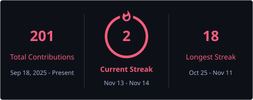

<h1 align="center">Hi 👋🏻 I'm Sourabh Kumar</h1>

<h3 align="center">VLSI Design | FPGA | Hardware Acceleration | Embedded Systems</h3>

  

  
  

---

### 🚀 About Me

- 🔧 VLSI & hardware design student working on **RTL design and digital hardware**
- 🧠 Exploring **systolic arrays & AI acceleration** on FPGAs
- 📡 Built a **3D FMCW MIMO radar pipeline** (Range → Doppler → Angle) in SystemVerilog for the KC705
- ❤️ Deployed an **ECG arrhythmia classifier** on a Zynq FPGA (PYNQ-Z2)
- 🔌 Working with **ESP32** and embedded systems
- 🤝 Open to collaborating on **RTL, FPGA and hardware projects**
- 📫 Reach me via the links below!

---

### 🛠️ Tech Stack

**Hardware / VLSI**

  
  
  
  
  

**EDA / Tools**

  
  
  

**Software / ML**

  
  
  
  
  
  

---

### 📂 Projects

<!-- REPOS:START -->
<!-- auto-generated by scripts/update_repos.py — edits here are overwritten -->

| Project | What it does | Stack | ⭐ | Updated |
|:--|:--|:--|:-:|:-:|
| [Fft Radar 3d Engine](https://github.com/sourabhkumar-96/fft-radar-3d-engine) | <i>Description coming soon</i> | SystemVerilog | 0 | Sep 2026 |
| [Ecg Arrhythmia Classifier](https://github.com/sourabhkumar-96/ecg-arrhythmia-classifier) | ECG arrhythmia classifier on a Zynq FPGA (PYNQ-Z2): Pan-Tompkins QRS detector + INT8 1D-CNN sharing one DSP. 97.05% on-board accuracy, bit-exact verified. | Python | 0 | Oct 2026 |
| [Can Esim](https://github.com/sourabhkumar-96/can-esim) | <i>Description coming soon</i> | VHDL | 0 | Sep 2026 |
| [esp32 Wireless Buggy Control](https://github.com/sourabhkumar-96/esp32-wireless-buggy-control) | Real-time wireless buggy control using ESP32, WebSockets, and a browser-based interface for low-latency motor control with dynamic speed adjustment. | C++ | 0 | Apr 2026 |
| [Hand Gesture Recognition](https://github.com/sourabhkumar-96/hand-gesture-recognition) | End-to-end hand gesture recognition system using deep learning, OpenCV, and MediaPipe with real-time webcam inference. | Python | 0 | Apr 2026 |

5 public repos · auto-synced 30 Oct 2026

<!-- REPOS:END -->

---

### 📊 GitHub Stats

  <picture>
    <source media="(prefers-color-scheme: dark)" srcset="./profile/github-stats.svg" />
    <source media="(prefers-color-scheme: light)" srcset="./profile/github-stats-light.svg" />
    
  </picture>

---

### 🐍 Contribution Snake

  <picture>
    <source media="(prefers-color-scheme: dark)" srcset="https://raw.githubusercontent.com/sourabhkumar-96/sourabhkumar-96/output/github-contribution-grid-snake-dark.svg" />
    <source media="(prefers-color-scheme: light)" srcset="https://raw.githubusercontent.com/sourabhkumar-96/sourabhkumar-96/output/github-contribution-grid-snake.svg" />
    
  </picture>

---

### 🌐 Connect with Me

  
  

